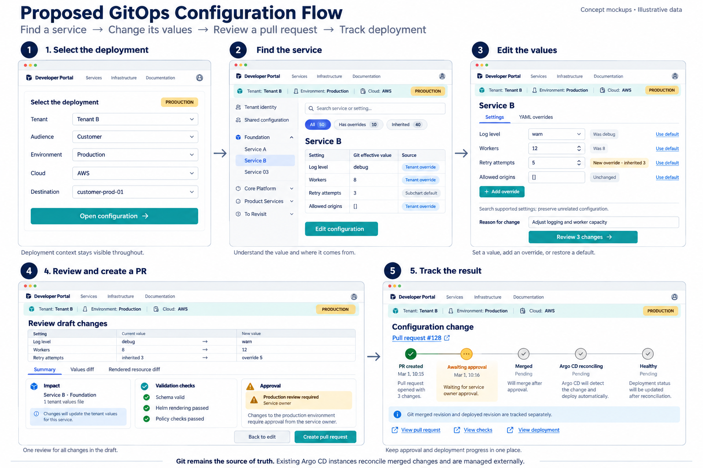
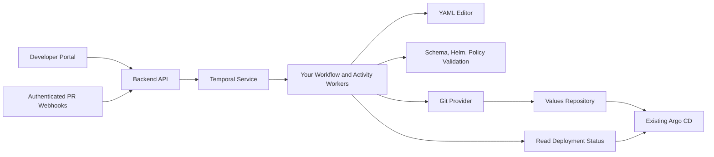

# GitOps IDP configuration design

A developer experience for changing tenant service values through pull requests,
with Temporal coordinating validation, review, Git operations, and deployment observation.

**Status: design handoff.** This repository contains a UI concept, backend flow,
and proposed API contract. It does not contain a running API or Temporal worker.

## Proposed interface

The image is a concept mockup with illustrative deployment context. The flow is:

1. Select the tenant deployment: audience, environment, cloud, and destination.
2. Find a service and inspect effective Git values and their inheritance sources.
3. Change a value, add an override, or remove an override to restore the default.
4. Review the values diff, rendered resource differences, and validation results.
5. Create a pull request and follow approval, merge, reconciliation, and health.

The Settings and YAML override modes edit the same draft. The YAML mode is scoped
to the selected service, while the tenant values file remains a single file.

## Backend

Your workers execute the workflow and activity code. Temporal persists workflow
progress and coordinates task execution; Git remains the desired-state source.
Argo CD instances, cluster registration, installation, and management are external.
The IDP observes deployment and does not apply resources directly to clusters.

## Read the design

- [Backend workflow, activities, and safeguards](docs/backend-flow.md)
- [API contract and request/response examples](docs/api.md)
- [Sample change request](examples/create-change.request.json)
- [Sample review-ready response](examples/change-ready.response.json)
- [Full-size interface image](assets/proposed-interface-flow.png)

## Example

The Tenant B example changes Service B's worker count from `8` to `12` and adds
`retry.maxAttempts: 5`, overriding the inherited subchart value of `3`.
The existing file contains 225 lines, with 10 customized services and 40 services
inheriting defaults. These example service values come from the POC; the Customer /
Production / AWS placement in the image is illustrative.

Adding a supported setting is a values change. Adding a new application capability
can also require a chart or service implementation change.

## Suggested implementation

- API: FastAPI and Pydantic.
- Orchestration: Temporal Python SDK and separate worker processes.
- Editing: `ruamel.yaml` for targeted round-trip YAML edits.
- Validation: chart schemas, pinned Helm rendering, and platform policy checks.
- Git access: a scoped GitHub App integration.
- Artifacts: object storage for larger previews and rendered differences.
- Optional database: searchable request metadata and audit indexes; not a second
  authoritative copy of tenant configuration.

These are proposed choices, not implemented dependencies.
