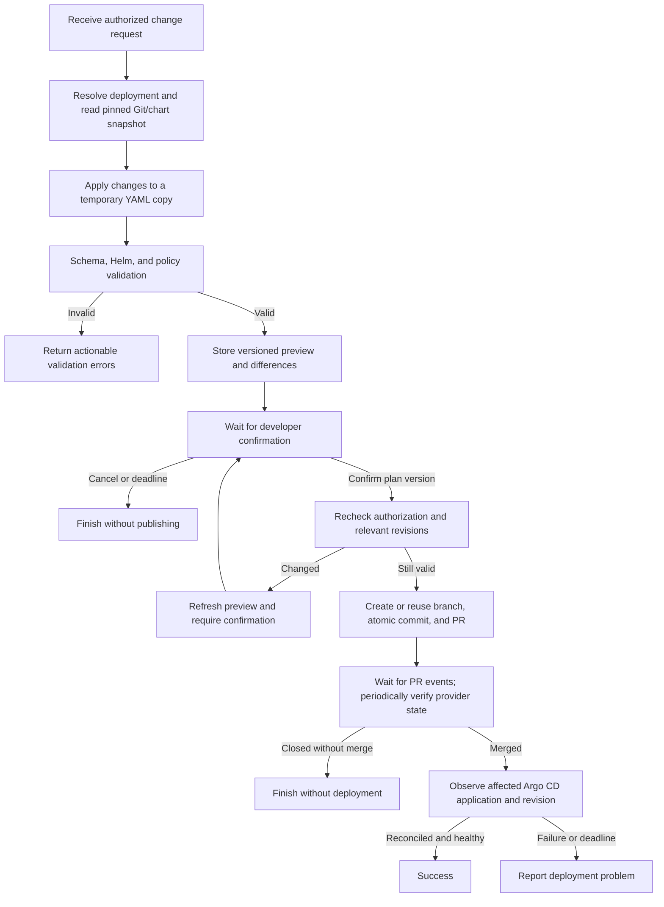

# Temporal backend flow

## Responsibilities

| Component | Responsibility |
|---|---|
| Backend API | Authenticate and authorize callers, validate request shape, resolve deployment identity, start workflows, submit confirmation, expose status |
| Temporal Service | Persist workflow history and coordinate durable execution |
| Workflow worker | Execute deterministic orchestration code, track domain state, wait for external events, manage deadlines |
| Activity worker | Perform Git/network/filesystem operations, edit YAML, render Helm, validate policies, observe deployment |
| Git provider | Store branches, commits, PR review, checks, and merge state |
| Existing Argo CD | Pull merged desired state and reconcile the affected applications |
| Artifact storage | Store larger previews and render output with appropriate access control |

Start with one codebase and workflow, with worker processes deployed separately
from the API. Separate validation and Git activity task queues if their scaling,
resource, or credential requirements justify it.

## Workflow: ConfigurationChangeWorkflow

Use a stable workflow ID derived from the change request ID. The API's idempotency
key must resolve retries to the same request. The workflow input contains the
actor identity, deployment ID, requested operations, reason, and request ID.
It does not accept an arbitrary repository path or destination chosen outside
the caller's permitted deployment catalog.



The developer's preview confirmation creates a PR; production approval remains
in the Git review process. Avoid requiring a second identical approval in the
portal unless platform policy explicitly calls for it.

## Activities

| Activity | Inputs / result |
|---|---|
| `resolve_and_authorize` | Resolve deployment, trusted file path, permitted service, chart revision, destination, and Argo instance |
| `read_snapshot` | Read values, schemas, and chart defaults at recorded commit/release revisions |
| `build_candidate` | Apply requested service-relative operations and store a candidate artifact |
| `validate_candidate` | Validate value types and schemas, render relevant charts, enforce policies and expected resource scope |
| `build_preview` | Record human-readable changes, values diff, rendered resource differences, artifact references, and plan version |
| `recheck_plan` | Reauthorize and compare relevant source revisions before publication; reject stale plans |
| `publish_pull_request` | Create/reuse a request-specific branch, publish the validated candidate, and create/reuse its PR |
| `get_pull_request_state` | Verify PR state, checks, and merge commit from the Git provider |
| `get_deployment_state` | Check the correct Argo instance, affected group, observed revision, conditions, and health |

Activities do external work. Workflow code contains deterministic decisions and
uses Temporal's durable waiting/timer APIs. A worker need not remain occupied
while the workflow waits for developer input or a Git review.

## Change semantics

- `set`: add or replace a supported setting within the selected service.
- `remove`: delete a tenant override, restoring inherited behavior; show the
  resulting effective value before confirmation.
- Treat `false`, `0`, `[]`, and removal as distinct operations/states.
- Replace lists as whole values in the initial API. Do not silently append or
  merge list elements; more specific list operations need an explicit contract.
- Preserve unrelated service and shared configuration. Round-trip YAML editing
  should preserve comments/formatting where possible; it is not byte-preservation
  for every YAML syntax feature. Reject duplicate keys, handle aliases/anchors
  deliberately, and verify the semantic diff stays within the allowed scope.
- A newly added setting must be supported by the selected chart. Unknown settings
  are accepted only where that chart's schema and platform policy permit them.

## Waiting and status

Use a Temporal Update or Signal for a validated preview confirmation, with the
expected plan version. The API is the authentication and authorization boundary.
Use a Query for compact current workflow state if appropriate; do not return large
rendered manifests from workflow state. Serve stored preview artifacts through
an authorized API or short-lived links.

Git webhooks are authenticated, deduplicated, correlated to the PR/change ID,
and delivered to the workflow as events. The workflow verifies provider state
rather than treating an event payload as authoritative. Durable timer-based
checks cover missed or delayed webhooks.

Expose domain states such as:

```text
PLANNING -> READY_FOR_REVIEW -> CREATING_PR -> WAITING_FOR_MERGE
         -> RECONCILING -> SUCCEEDED
```

Other outcomes include `VALIDATION_FAILED`, `CANCELLED`, `PR_CLOSED`,
`DEPLOYMENT_FAILED`, and `TIMED_OUT`. A refreshed plan increments `planVersion`
and returns to `READY_FOR_REVIEW`. These are application states, distinct from
Temporal's own Workflow Execution statuses.

## Safety and recovery

1. **Idempotent Git writes:** retries reuse a stable branch and PR identity. If
   a provider request times out, inspect existing state before creating anything
   again. Temporal does not make external side effects exactly-once automatically.
2. **Concurrency:** tie each preview to relevant Git/chart revisions and the
   candidate content digest. Recheck before publishing, use conditional branch
   updates, and never force-overwrite unrelated concurrent edits. CI must validate
   the actual PR commit again against the integration/merge target.
3. **Validation failures:** return field paths and actionable errors; do not retry
   invalid input as though it were a transient network outage.
4. **Bounded retries:** configure activity timeouts and retries by error type.
   Heartbeat long validation tasks and ensure their temporary workspaces are
   reproducible on another worker.
5. **Cancellation:** before publication, cancel without Git writes. After a PR
   exists, report that fact and apply an explicit PR-closing policy. After merge,
   report observed deployment state; do not automatically revert Git on a timeout.
6. **Deployment success:** Git merge is not deployment success. Verify the
   relevant values source revision (or a later descendant containing the change),
   affected application sync state, health, and errors. Multi-source Applications
   need source-specific revision checks. ConfigMap health alone does not prove
   application traffic or service readiness.
7. **Credentials and artifacts:** keep integration credentials and secret values
   outside workflow inputs, history, previews, and logs. Fetch credentials in
   activities and store secret references in Git configuration.
8. **Worker upgrades:** version long-lived workflow code using Temporal-supported
   mechanisms so requests waiting on approvals can resume safely after deployment.

## References

- [Temporal workflow definition and determinism](https://docs.temporal.io/workflow-definition)
- [Temporal activity idempotency](https://docs.temporal.io/activity-definition)
- [Temporal Python workflow message passing](https://docs.temporal.io/develop/python/workflows/message-passing)
- [Temporal retry policies](https://docs.temporal.io/encyclopedia/retry-policies)
- [Round-trip YAML editing](https://yaml.dev/doc/ruamel.yaml/detail/)
